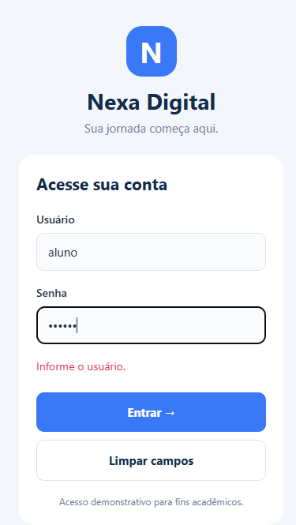
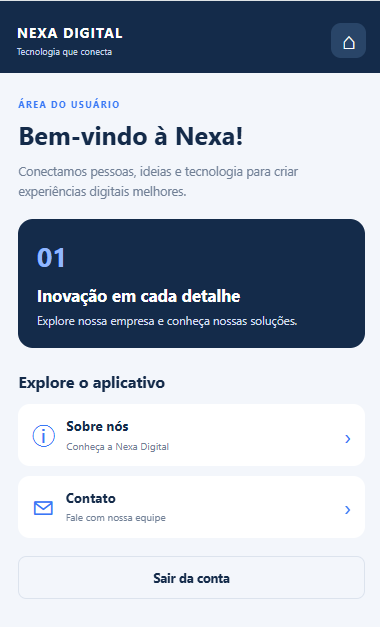
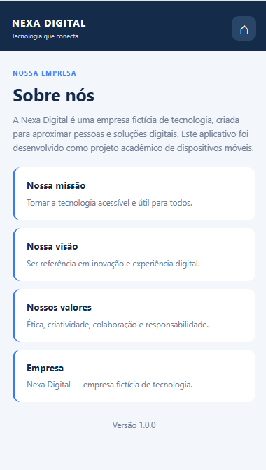
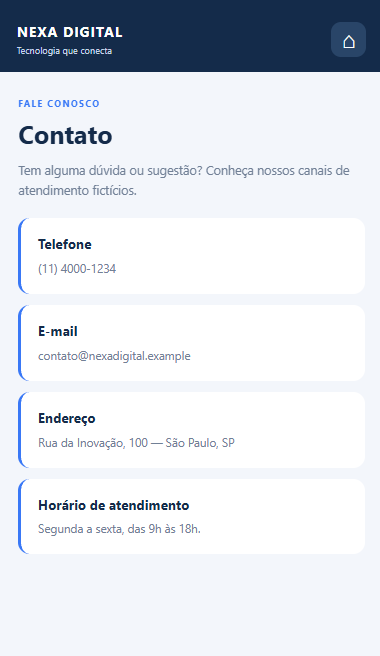

# Nexa Digital

Aplicativo mobile desenvolvido com React Native e Expo para uma atividade acadêmica da FATEC.

## Funcionalidades

- Tela de login
- Tela inicial
- Tela Sobre
- Tela de contato
- Navegação entre as telas

## Tecnologias utilizadas

- React Native
- Expo
- JavaScript

## Acesso ao aplicativo

**Usuário:** `aluno`  
**Senha:** `123456`

## Capturas de tela

### Login

### Home

### Sobre

### Contato

## Objetivo

Projeto desenvolvido para praticar a criação de interfaces mobile e a navegação entre telas.
